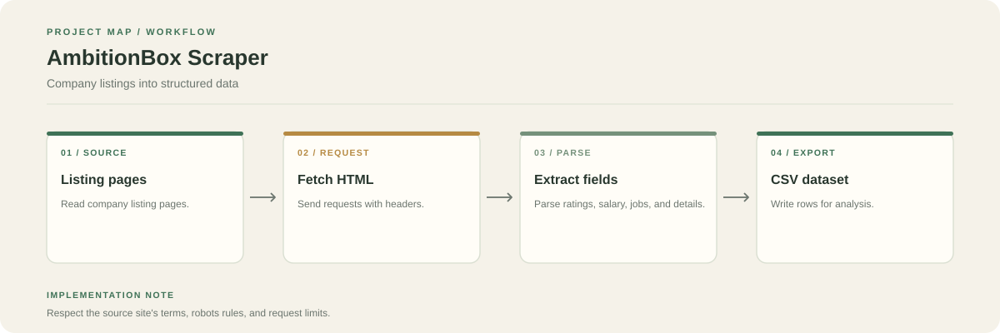

# AmbitionBox Companies Web Scraper

Collect company listing details and save them as a structured CSV for further analysis.

**Stack:** Python, Requests, BeautifulSoup, Pandas, Jupyter Notebook



## Workflow

1. Request listing pages from AmbitionBox.
2. Parse the returned HTML.
3. Extract available company fields, including names, ratings, reviews, salary information, jobs, and descriptions.
4. Store the collected rows in a Pandas DataFrame and export them to CSV.

## Output

The repository includes `ambitionbox_companies.csv` and the notebook `my.ipynb`.

## Run

```bash
git clone https://github.com/chyk2468/AmbitionBox-Companies-Web-Scraper.git
cd AmbitionBox-Companies-Web-Scraper
pip install pandas requests beautifulsoup4 jupyter
jupyter notebook my.ipynb
```

## Notes

Website structure can change, so selectors may need updating. Review AmbitionBox's terms and access rules before running a scrape. Do not use collected data to mislead readers or imply official endorsement.
