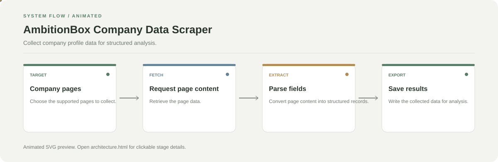

# AmbitionBox Company Data Scraper

**Collect company profile data for structured analysis.**

[](https://github.com/chyk2468/AmbitionBox-Companies-Web-Scraper)

## 1. Project Title & Tagline

Collect company profile data for structured analysis.

## 2. Problem Statement

Company details and workplace information can be scattered across many pages. This project automates collecting selected public company information into a more usable dataset.

## 3. Project Preview

Add a real screenshot, GIF, or public demo after running the project. For a starter repository, show the first working experiment here.

[Open interactive architecture](architecture.html)

## 4. Overview

The project follows a clear workflow from input collection through processing to a reviewable output. See the repository entry point and configuration for the exact implementation details.

## 5. Key Features

- Scrape supported company pages.
- Extract structured company fields.
- Store collected data for later analysis.
- Reuse the collected dataset in notebooks or scripts.

## 6. Architecture / Workflow



Open the [interactive architecture explorer](architecture.html) to select a stage and read its role.

## 7. Tech Stack

Python, Requests, BeautifulSoup, Pandas

## 8. Installation & Setup

```bash
git clone https://github.com/chyk2468/AmbitionBox-Companies-Web-Scraper.git
cd AmbitionBox-Companies-Web-Scraper
pip install -r requirements.txt
```

## 9. Usage

Run the scraper entry point documented in the repository, review the configured target and output path, then inspect the exported data before analysis.

## 10. Project Structure

Start with the main scraper script, then follow the parsing, output, and configuration modules.

## 11. Results & Demo

Run against a small sample first and record the number of pages processed, records extracted, and fields missing. Respect the target site's terms and rate limits.

## 12. Future Enhancements

- Add retry and backoff handling.
- Validate and deduplicate extracted records.
- Add tests for changing page layouts.
- Document the output schema.

## 13. License

Check the repository license and the target site's terms before reusing code or collected data.
