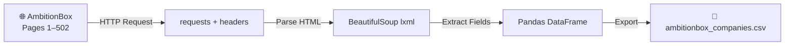

# 🏢 AmbitionBox Companies Web Scraper

<div align="center">


<br/>

> **A powerful Python web scraper that collects company data from [AmbitionBox](https://www.ambitionbox.com/list-of-companies) — India's #1 platform for company reviews, salaries & job listings.**

</div>

---

## 📌 Overview

This project automatically scrapes **10,000+ companies** across **502 pages** from AmbitionBox and saves all extracted data into a clean, structured CSV file — ready for analysis, visualization, or research.

---

## ✨ Features

| Feature | Description |
|---------|-------------|
| 🔍 **Mass Scraping** | Covers 500+ pages of AmbitionBox listings |
| 📊 **Rich Data** | Extracts 6 key fields per company |
| 🛡️ **Error Handling** | Gracefully handles missing or malformed data |
| ⚡ **Efficient Output** | Saves 10,000+ records into a single CSV |
| 🧩 **Easy to Extend** | Clean, modular notebook structure |

---

## 📦 Data Fields Extracted

```
📁 ambitionbox_companies.csv
├── 🏷️  Name         → Company name
├── ⭐  Rating        → Employee rating (out of 5)
├── 💬  Reviews       → Total number of reviews
├── 💰  Salary        → Average salary reported
├── 💼  Jobs          → Number of open positions
└── 📝  Description   → Industry & headquarters location
```

---

## 🧠 How It Works



---

## 🧩 Sample Output

| Name | Rating | Reviews | Salary | Jobs | Description |
|------|--------|---------|--------|------|-------------|
| TCS | 3.4 | (1.1L) | 9.4L | 1.1k | IT Services & Consulting \| Bangalore +427 |
| Infosys | 3.5 | (45.3k) | 5.1L | 1.6k | IT Services & Consulting \| Bangalore +236 |
| Accenture | 3.7 | (67.5k) | 6.3L | 34.7k | IT Services & Consulting \| Bangalore +241 |
| HDFC Bank | 3.8 | (47.4k) | 1.4L | 175 | Banking \| Mumbai +1760 |
| Google | 4.4 | (1.8k) | 27.5L | 528 | Software Product \| Bangalore +84 |

---

## ⚙️ Requirements

Install dependencies with:

```bash
pip install requests beautifulsoup4 lxml pandas
```

Or use the one-liner:

```bash
pip install -r requirements.txt
```

> **Python 3.7+** is recommended.

---

## 🚀 Getting Started

**1. Clone the repository**
```bash
git clone https://github.com/YashwantChitchula/AmbitionBox-Companies-Web-Scraper.git
cd AmbitionBox-Companies-Web-Scraper
```

**2. Install dependencies**
```bash
pip install requests beautifulsoup4 lxml pandas
```

**3. Run the notebook**
Open `my.ipynb` in Jupyter Notebook or VS Code and run all cells.

**4. Check the output**
```
✅ Scraping completed!
📄 ambitionbox_companies.csv  →  10,000+ companies saved!
```

---

## 📁 Project Structure

```
AmbitionBox-Companies-Web-Scraper/
│
├── 📓 my.ipynb                      # Main scraper notebook
├── 📄 ambitionbox_companies.csv     # Scraped dataset (~846 KB, 10k+ rows)
└── 📘 README.md                     # Project documentation
```

---

## ⚠️ Disclaimer

> This project is intended for **educational and research purposes only**.  
> Frequent or aggressive scraping may violate AmbitionBox's [Terms of Service](https://www.ambitionbox.com/terms).  
> Please scrape responsibly and respect server bandwidth.

---

## 👨‍💻 Author

<div align="center">

**Yashwant Kumar Chitchula**  
🎓 B.Tech CSE (AI & ML) — VIT Chennai

[](https://github.com/YashwantChitchula)

</div>

---

<div align="center">

⭐ **If you found this project helpful, give it a star!** ⭐

</div>
